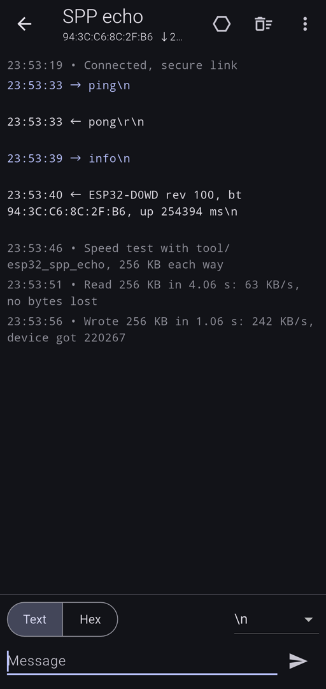

# bluetooth_serial_next

[](https://pub.dev/packages/bluetooth_serial_next)
[](https://github.com/Zalexei/bluetooth_serial_next/actions/workflows/ci.yml)

Talk to HC-05 and HC-06 modules, ESP32 boards running `BluetoothSerial`,
ELM327 OBD-II adapters, receipt printers and other Bluetooth Classic serial
devices (SPP over RFCOMM) from a Flutter app on Android.

It is a maintained successor to
[`flutter_bluetooth_serial`](https://pub.dev/packages/flutter_bluetooth_serial),
which has had no release since 2021 and no longer builds with current
Android Gradle Plugin versions.

- Paired devices, scanning for new ones, pairing.
- The Android 12+ "nearby devices" permission, and the location permission
  that Android 6 to 11 need for scanning, with one call.
- Connecting that copes with real devices: secure first, then insecure, or
  straight to an RFCOMM channel for adapters that do not advertise the
  service (many ELM327 clones), all within one timeout, with a watchdog
  for Android's `connect()`, which has none.
- Received data as a `Stream<Uint8List>`, or as lines; writes that complete
  when the data went out, with a timeout.
- A `SerialException` with a `SerialError` for every failure, also for
  "Bluetooth is off", "not paired" and "the device did not answer", instead
  of a generic `IOException`.
- The ports implement `SerialPort` from
  [`serial_port_core`](https://pub.dev/packages/serial_port_core), the same
  interface as [`usb_serial_next`](https://pub.dev/packages/usb_serial_next):
  protocol code written once works over Bluetooth and USB.
- Flutter 3.27 and newer, no other dependencies.



## Speed

Measured with the example's speed test against
[`tool/esp32_spp_echo`](tool/esp32_spp_echo), 256 KB each way, Xiaomi 14T
Pro and an ESP32-WROOM-32 with a signal of -84 dBm:

| Direction | Speed |
|---|---|
| Device to phone | 58 to 63 KB/s, no bytes lost |
| Phone to device | 111 to 242 KB/s |

Writing, the phone is faster than the ESP32's Arduino `BluetoothSerial`
library: it drops what does not fit its 512-byte receive queue, so at
242 KB/s the device counted 220 267 of 262 144 bytes (at 111 KB/s all of
them). Devices that read fast enough, or use RFCOMM flow control, get
everything.

SPP is far slower than USB (about 820 KB/s in with usb_serial_next) and
depends on distance and on the device's firmware; HC-05 modules are limited
by their UART, 115200 baud by default, about 11 KB/s.

## Platforms

| Android | iOS | Web, desktop |
|---|---|---|
| 5.0+ (API 21) | – | – |

iOS lets apps use Bluetooth Classic only with MFi accessories, so this
plugin cannot exist there; for iOS use a Bluetooth Low Energy module with a
BLE package. Calls on other platforms throw `SerialException` with
`SerialError.unsupportedOperation`; check `BluetoothSerial.isSupported`.

## Setup

The plugin's manifest adds the permissions; there is nothing to add to
yours:

| Permission | Android | For |
|---|---|---|
| `BLUETOOTH_CONNECT` | 12+ | paired devices, pairing, connecting |
| `BLUETOOTH_SCAN` (`neverForLocation`) | 12+ | scanning |
| `ACCESS_FINE_LOCATION` (`maxSdkVersion` 30) | 6 to 11 | scanning |
| `BLUETOOTH`, `BLUETOOTH_ADMIN` | all | Android 11 and older; granted at install |

`BLUETOOTH` and `BLUETOOTH_ADMIN` are declared without `maxSdkVersion` on
purpose: some Xiaomi phones on Android 12 still check `BLUETOOTH` when a
socket connects. If your app never scans, remove the scan permissions in
your manifest:

```xml
<manifest xmlns:tools="http://schemas.android.com/tools" ...>
  <uses-permission android:name="android.permission.BLUETOOTH_SCAN" tools:node="remove" />
  <uses-permission android:name="android.permission.ACCESS_FINE_LOCATION" tools:node="remove" />
```

## Usage

```dart
import 'package:bluetooth_serial_next/bluetooth_serial_next.dart';

final bt = BluetoothSerial.instance;

if (!await bt.requestPermissions()) return; // "Nearby devices" on Android 12+
if (!await bt.requestEnable()) return; // "Turn Bluetooth on?"

final devices = await bt.bondedDevices();
final device = devices.firstWhere((d) => d.name == 'HC-05');

final port = await bt.open(device.address);
port.lines().listen(print);
await port.writeText('AT\r\n');
...
await port.close();
```

### Scanning and pairing

```dart
if (await bt.requestPermissions(scan: true)) {
  // Runs about 12 seconds; cancel the subscription to stop earlier. A device
  // can come more than once as its name becomes known.
  final subscription = bt.discover().listen((d) => print('${d.address} ${d.name} ${d.rssi} dBm'));
}

// The system dialog; HC-05 and HC-06 ask for a PIN, usually 1234 or 0000.
final paired = await bt.bond('98:D3:31:F5:2A:1C');
```

You do not have to pair first: a secure connection to a device that is not
paired makes Android pair with it.

### Connecting

```dart
// Secure, then insecure: what most devices need.
final port = await bt.open(address);

// ELM327 clones often have no service record: connect to channel 1.
final obd = await bt.open(address, channel: 1);

// Only one kind of link; 30 seconds for a slow device.
final strict = await bt.open(
  address,
  security: BluetoothSecurity.secure,
  timeout: const Duration(seconds: 30),
);
print(port.isSecure); // which kind auto got
```

`uuid:` picks another service than the serial port profile.

### Text and lines

`lines()` decodes UTF-8 (or another `encoding:`) and splits on `\n`, `\r\n`
and `\r`, also when a line arrives in several pieces, which over Bluetooth
it usually does. `writeText` encodes a string; add the line ending the device
expects.

### Writes

`write` completes when the data went out. The default timeout allows
10 KB/s plus two seconds; on a timeout the `SerialException` has
`bytesWritten`. `timeout: Duration.zero` waits forever.

### Connection lost, Bluetooth off

When the device goes out of range or is switched off, `input` emits a
`SerialException` with `SerialError.disconnected` and ends (Android notices
after its link supervision timeout, about 5 seconds), and `closed`
completes with it. When Bluetooth is turned off, all ports close with
`SerialError.adapterOff`. `adapterStateChanges` and `bondStateChanges` tell
what happens in the meantime.

## Errors

Every method throws `SerialException`; its `error` says what happened:

| `SerialError` | When |
|---|---|
| `permissionDenied` | The user said no, or `open(requestPermission: false)` without permission; for a scan on Android 6 to 11 also when location is off |
| `adapterOff` | Bluetooth is off, or was turned off while connected |
| `notPaired` | `security: secure` to a device that is not paired and did not pair |
| `connectionFailed` | The device did not take the connection: off, out of range, no such service, or connected to another phone. `message` lists each try |
| `timeout` | No connection within `timeout`, or a write did not finish in time |
| `disconnected` | The link was lost while open; `input` ends with this error |
| `portClosed` | The port was closed before or during the call |
| `busy` | Already connected or connecting to this address |
| `invalidArgument` | Not a Bluetooth address, a UUID or a channel from 1 to 30 |
| `unsupportedOperation` | No Bluetooth, not Android, or no activity for a dialog |
| `io` | Anything else; see `message` |

After a hot restart the plugin closes ports the previous Dart code left open,
so they are not `busy`.

## Moving from flutter_bluetooth_serial

| flutter_bluetooth_serial | bluetooth_serial_next |
|---|---|
| `FlutterBluetoothSerial.instance` | `BluetoothSerial.instance` |
| `isAvailable`, `isEnabled`, `state` | `isAvailable()`, `getAdapterState()` |
| `onStateChanged()` | `adapterStateChanges` |
| `requestEnable()` | `requestEnable()`; permissions first with `requestPermissions()` |
| `getBondedDevices()` | `bondedDevices()` |
| `startDiscovery()` (`BluetoothDiscoveryResult`) | `discover()` (`BluetoothSerialDevice` with `rssi`) |
| `cancelDiscovery()` | cancel the subscription |
| `bondDeviceAtAddress(address)` | `bond(address)` |
| `BluetoothDevice` | `BluetoothSerialDevice` (no clash with BLE packages) |
| `BluetoothConnection.toAddress(address)` | `BluetoothSerial.instance.open(address)` |
| `connection.input` | `port.input` |
| `connection.output.add(data); await connection.output.allSent` | `await port.write(data)` |
| `connection.isConnected` | `port.isOpen` |
| `connection.close()`, `finish()`, `dispose()` | `port.close()` |
| errors as `PlatformException` | `SerialException` with `SerialError` |

Not there: entering the PIN for the user (`setPairingRequestHandler`),
removing a pairing, making the phone discoverable, the phone's own name and
address, and accepting connections (server mode). Open an issue if you need
one of them.

## Architecture

`SerialPort` (from `serial_port_core`) is the transport-neutral part:
`input`, `write`, `close`, `closed`, `lines()`, `writeText()`.
`BluetoothSerialPort` implements it and adds `address` and `isSecure`.

On the native side, connecting runs off the main thread: each try gets the
time left of the timeout, and a watchdog closes the socket when it is up.
Each open port has a reading thread and a writing thread; reads that arrive
while the previous chunk is still on its way to Dart are joined, the same as
in `usb_serial_next`.

## Tested on

| Phone | Device | What was checked |
|---|---|---|
| Xiaomi 14T Pro, Android 16 (HyperOS) | ESP32-D0WD (ESP32-WROOM-32), Arduino `BluetoothSerial` | permission dialog, scan, pairing on the first secure connect, secure, insecure and channel 1 links, echo, 256 KB each way without loss, the device dropping the link, Bluetooth turned off while connected, the "turn on" dialog, a paired device that is switched off (`connectionFailed` after about 13 s), the device losing power while connected (`disconnected` after about 5 s) |

HC-05, HC-06, ELM327 and printers are expected to work but have not been
tested; reports are welcome.

## Example

[`example/`](example) is a terminal: paired and nearby devices, connect
with a tap or with a chosen security or channel, text or hex. Flash
[`tool/esp32_spp_echo`](tool/esp32_spp_echo) to an ESP32 (the original one:
S2, S3, C3 and C6 have no Bluetooth Classic) to have a device that answers.

## License

MIT, see [LICENSE](LICENSE).
